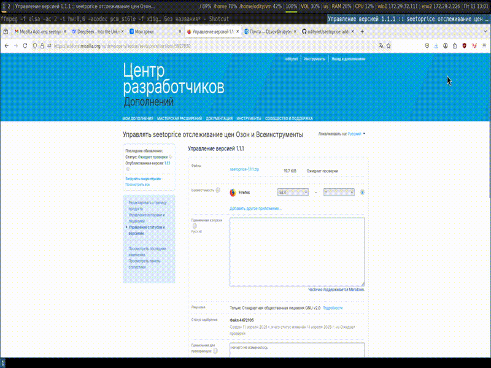
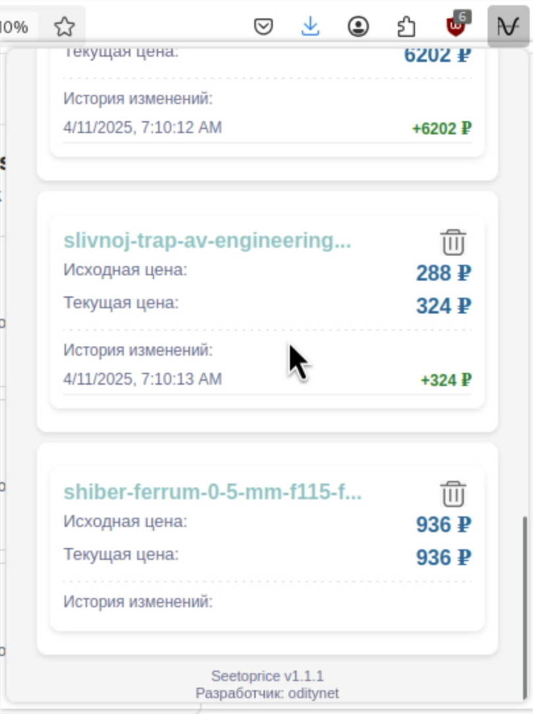
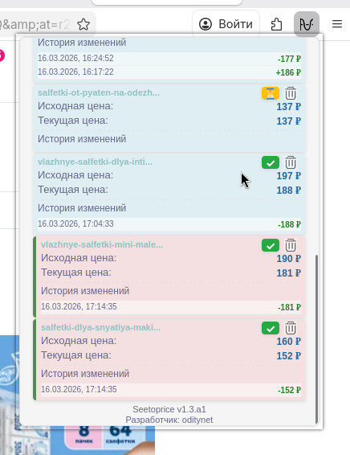
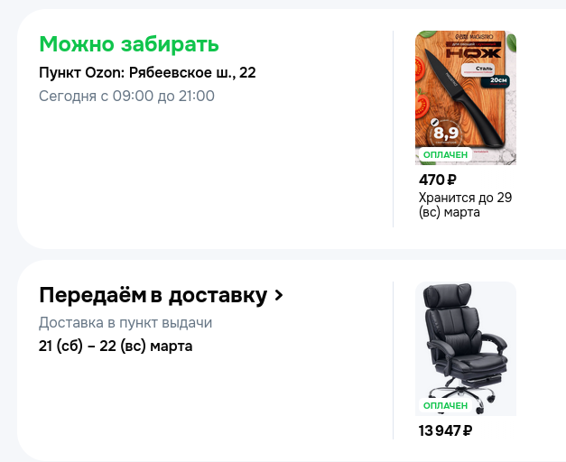
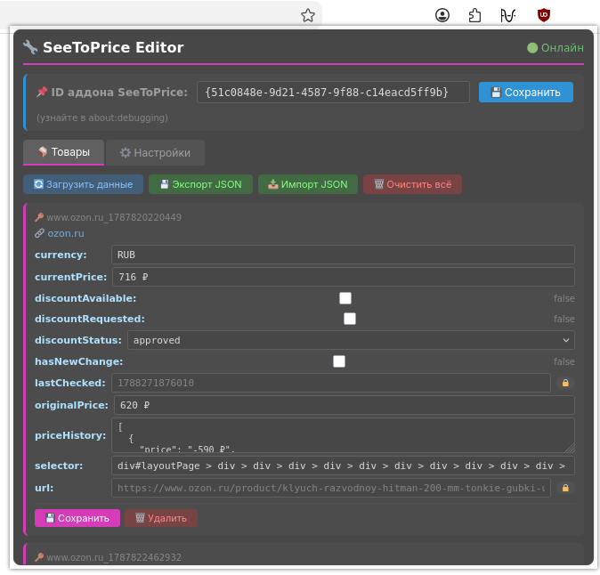

<a name="readme-top"></a>
<div align="center">
    
<br>
    
# seetoprice

<!-- SHIELD GROUP -->

[![][github-stars-shield]][github-stars-link]
[![][github-license-shield]][github-license-shield]<br/>

Addon for firefox !!! https://addons.mozilla.org/firefox/downloads/file/5000060/seetoprice-1.3.2.1.xpi
https://addons.mozilla.org/ru/firefox/addon/seetoprice/

Addon for Chrome (I not have a 5$)

https://www.youtube.com/watch?v=CMbLMl-Z-nI

<a name="readme-left"></a>
<div align="left">

Плагин для Firefox/Chrome браузера для слежения за динамикой цен на сайтах www.vseinstrumenti.ru,  www.ozon.ru, www.wildberries.ru,  www.avito.ru (Всеинструменты, Озон, (Вальберис, Авито с версии 1.2) ). 

# Замечания разработчика

После полу года наблюдением за ценами автор пришел к выводу,что платформа озон дает 100% скидки определенным кругам лиц на пару минут. Время выбирается очень не приемленное для большинства глаз. Аддон может помочь вам поймать настоящую скидку, но для этого может понадобится время. (подтверждение моим слован см на фото при скачивания аддона браузера firefox)

Обновления адона по нескольку месяцев не подверждает AMO: https://discourse.mozilla.org/t/the-addon-has-been-unable-to-pass-verification-for-2-months/148387

# Инструкция пользования 

1) Зайти на страницу желаемой вещи
2) Правой клавишей мыши кликнуть по цене
3) В меню выбираете "отслеживать цену" и товар помещается в список. Список можно увидел в панели аддонов. Обновление цены происходит каждые 10 минут и в случае изменения цен вам будет выдано уведомление.
4) Скачайте готовый аддон из шапки данного руководства
5) Если вы хотите добавить tg бота,то вам нужно через botfather создать его в свое аккаунте,получить api ключ и вставить в аддон. Если при нажатии на кнопку ничего не происходит,то(!!!) зайдите в свой бот,отправьте в него /start и дальше в аддоне ещё раз введите ключ и сохраните. (решение проьлемы протестировано несколько раз)

# Seetoprice editor - отдельный аддон для дебаг \ разработчик режима 

Аддон позволяет изменить паттер товара ,если он изменился на сайта, а обновление еще не вышло. Инструрмент для разработки и отладки.

- Принцип работы: вводите id вашего установленного аддона seetoprice (настройки -> расширения -> seetoprice ->  Шестеренка -> Debug Add-on - > Extension ID (скопировать полностью))
- Вставить ID в аддон editor. Т.к. каждый аддон имеет свою изолированную область  в local stortage, то обмен данными я осуществляю через API встроенный в аддон, который появился в версии 1.3.2.1. Ниже этой версии вы ничего не получите.


selector - это паттерн, по которому ищется цена на сайте. Структура легко понятна,если возьмете к примеру паттерн "button.priceBlockWalletPrice--K6fNr > div > div > h2"  и увидите что на странице цена была 1 811 ₽, а код страницы имел формат:

```
<div class="mo-flex mo-button__content"><div class="mo-flex mo-flex_align-items_center mo-button__start-content"><div class="mo-icon mo-icon_colors_accent priceBlockIcon--SDi7n" style="--mo-icon-size: 24px;"><svg width="100%" height="100%" viewBox="0 0 24 24" fill="none" xmlns="http://www.w3.org/2000/svg"><path fill-rule="evenodd" clip-rule="evenodd" d="M11.2652 2.69516C10.6645 2.42465 10.1595 2.19721 9.73068 2.04459C9.28214 1.88493 8.8365 1.77616 8.35628 1.79762C7.62342 1.83038 6.91938 2.09259 6.34363 2.54719C5.96636 2.84508 5.70043 3.21886 5.4656 3.63303C5.24111 4.02895 5.00787 4.53135 4.73045 5.1289L4.27271 6.1148C4.03305 6.16272 3.82694 6.23064 3.63803 6.3269C3.07354 6.61452 2.6146 7.07346 2.32698 7.63795C2 8.27968 2 9.11976 2 10.7999V15.1999C2 16.8801 2 17.7202 2.32698 18.3619C2.6146 18.9264 3.07354 19.3853 3.63803 19.6729C4.27976 19.9999 5.11984 19.9999 6.8 19.9999H18.8C19.9201 19.9999 20.4802 19.9999 20.908 19.7819C21.2843 19.5902 21.5903 19.2842 21.782 18.9079C22 18.4801 22 17.92 22 16.7999V13.9999H17C16.4477 13.9999 16 13.5522 16 12.9999C16 12.4476 16.4477 11.9999 17 11.9999H22V9.19992C22 8.07982 22 7.51976 21.782 7.09194C21.5903 6.71562 21.2843 6.40965 20.908 6.21791C20.4802 5.99992 19.9201 5.99992 18.8 5.99992H18.6044L11.2652 2.69516ZM13.7333 5.99992L10.4804 4.53519C9.8338 4.24401 9.40304 4.05089 9.06001 3.92879C8.7281 3.81065 8.56039 3.79049 8.44559 3.79563C8.13151 3.80967 7.82977 3.92204 7.58302 4.11687C7.49284 4.18808 7.37916 4.31303 7.20539 4.6195C7.02648 4.93503 6.82783 5.36082 6.53107 5.99997C6.61826 5.99992 6.70787 5.99992 6.8 5.99992H13.7333Z" fill="currentColor"></path></svg></div></div><div class="mo-button__text-content"><h2 class="mo-typography mo-typography_variant_title2 mo-typography_variable-weight_title2 mo-typography_variable mo-typography_colors_accent">1&nbsp;811&nbsp;₽</h2></div></div>
```

Разбирайтесь :)

# Change:

В версии 1.4:
 - Добавил анализатор отзывов, свой подсчет рейтинга, N-gramm для вывода топ6 фраз, состоящих из 3 слов.
 - Описал подробный гайд по пользованию на сайте addons.mozilla.org 

В версии 1.3.2.1:

  1) Добавил отдельный аддон для редактирования параметров в local storage аддона seetoprice ( для режима отладки или редактирования паттернов для поиска цены, если изменения есть на сайте, а обновления еще не вышло )
  
  2) Добавил для Всеинстурменты уведомление если "Проверка я не робот" и VPN если включен.
  
  3) Исправил мелкие недочеты по интерфейсу и изменения статуса товара (если товар больше не продается и потом возвращается в продажу обратно и другие комбинации)

В версии 1.3.2: 

  1) Исправил поиск в ВБ цены, добавил уведомление,если включен ВПН и страница ВБ сообщает об этом. Удалил урезание трафика у ВБ, т.к. теперь стало бесмысленно.
   
  2) Удалил телеграм, т.к. прокси бесмысленнен в РФ, а MTProto нет в браузере. 
  
  3) Исправил ошибку в Петровиче при добавлении товара (редковоспроизводимая).
  
  4) Для сборки под Chrome поднял версию до актуальной

В версии 1.3.1.1: Ускорение работает только на страницы аддона. А то и все открываемые вами wb страницы тоже оптимизировались до нельзя :)

В версии 1.3.1: Я сделал невозможное. Wb теперь грузится мигом. Ошибки получения цены свелись к нулю. Тестирую дальше (см screen5.png)

Что я сделал: убрал фотографии, медиа и другие элементы, которые грузятся( Бывало некоторые доходили до 65мб!!!). Не знаю это ли полвлияло на существенный прирост в скорости или нет, но теперь страницы открываются моментом. Быстрее Озона. Это победа. Из-за WB я уже думал запкрою проект и не вывезу таких костылей...ведь с 1.3.0.5 я боролся с ценой на WB. РАБОТАЕМ!!!

В версии 1.3.0.8: bug fix 

В версии 1.3.0.7: 

 1) Парсинг цены в WB: сайт 15 секунд тратит на выдачу цены, когда ее 3 шт(кошелек, старая, оригинал) и не всегда берет правильную цену(явно разработчики DCOM грузят медленно), 6 секунд на цену из 2 шт (кошелек и старая) и 4 секунды когда просто одна цена. Это кошмар и АД(!!!)
 
 
 2) Всеинструменты добавили цену для юр и физ. лиц. Изменил паттерны
 
 3) Исправил баги с получением статуса по скидкам.
 
 4) Перетряхнул всю структуру цен на сайте Озон.
 
 5) Дни недели. Исправил баги. Структура изменилась
 
В версии 1.3.0.6: Bugfix с ценами и уведомлением.

В версии 1.3.0.5: Bugfix с ценами на WB, исправил дни недели на Озон. 

P.S:

 1) Прошу прощения за путаницус ценами для стран Таджикистана, Узбекистана и Кыргыстана. Я перепутал ваши валюты и в новой версии может быть путаница
 
 2) Выражаю благодарность разработчикам Озон, которые следят за моим проектом и внедрили в свой отображение дней недели. Мне было приятно слушать ваш доклад на pgconf про оптимизацию postgress на ваших морковках и то,что вы внедряете удобные фишки у себя (по другому до вас не достучаться)

В версии 1.3.0.4: Добавил для сайта Озон в разделе заказы отображение дня недели после числа. <a href="https://github.com/oditynet/seetoprice/blob/main/screen4.png" >фото</a> Мне всегда недоставало этой информации,чтоб понимать придет оно до выходных или нет. А Вам? ( ` Ожидается одобрение от AMO `)

В версии 1.3.0.3: Добавил подсветку товара, который снят с продажи на Озон. 

В версии 1.3.0.2: Устанил ошибкипо определению цены

В версии 1.3.0.1: Устанил ошибки. 

В версии 1.3: Добавил кнопку "запросить скидку" для сайта Озон. Всегда забывал об этой функции. Теперь кнопка показывает возможные состояния: а) нет кнопки - скидки нет б) кнопка белая - скидку можно запросить в) кнопка желтая - скидка запрошена и ожидается подтверждения продавцов г) Кнопка зеленая - скидка одобрена (обычно 5%). Статус меняется в момент проверки цены, а вот изменится ли цена - вопрос работы сайта

Комментарии разработчика: Вы можете заметить, что товар до авторизации стоит дешевле, чем после. Запрашивая скидку у продавца она может быть одобренна сразу, а может и через день, но за это время цена измениться может существенно, а размер скидки будет равняться как раз той сумме, которая была ДО авториации (накрутка видимо делается специально). Если цена вас устраивает,то по моему мнению лучше не ждать одобрения скидки от продавца,т.к. она может быть и отклонена или быть одобренной очень поздно.

`Актуальная`

В версии 1.2.2.7: Добавил новый список паттернов для сайта https://www.vseinstrumenti.ru

В версии 1.2.2.6: в windows firefox клиенте постоянно висел снизу скролл. Убрал этот лишний визуальный элемент

В версии 1.2.2.5: Сменил иконки.

В версии 1.2.2.3: исправил ошибки определения цены в петрович и леманапро. Некоторые цены стали уникальными

В версии 1.2.2.2: добавил импорт/экспорт товаров, fix bug chrome, добавил работу вкладок.

В версии 1.2.2.1: добавил 3 темы: светлая,минимальная,яркая.

В версии 1.2.2:
- Добавил поддержку ЛеманоПро, Петрович и Авто.ру
- Изменил внешний стиль

В версии 1.2.1.8: fix bug по валюте из некоторых стран

В версии 1.2.1.7:
- ozon, wb - добавлена поддержка всех языков.
- устранена ошибка обновления цен на wb ,т.к. разработчики данной платформы стараются скрыть цену от аддона.
- сортировка цен в аддоне по сайтам

В версии 1.2.1.6: Устарены все недочеты AMO и XSS-уязвимости для firefox.

В версии 1.2.1.5: Устранена проблема с перелистыванием в начало страницы, а в версии chrome пришлось удалить поддержку telegram потому что там запрещены прямые обращения к серверу, а настроить CORS я не осилил пока.

В версии 1.2.1.4: Смена лицензии на GPL 3.0

В версии 1.2.1: Добавлена поддержка wildberries, Avito и отправка уведомлений в ваш Telegram канал.
  
В версии 1.1.1: Добавлено цветовое выделение цены в списке для удобства поиска в списке товаров.

В версии 1.1:
   - добавлены новые иконки
   - изменение иконок в браузере,если цена изменена (т.н. визуальное оповещение)
   - изменение истории с отображение динамики цены + или - 
   - устранены ошибки ложных срабатований.
     
В версии 1.0.4.2: добавлена возможность  самому изменить колчество созраняемых записей в истории и время обновления цен

В версии 1.0.4 добавлена история до 5 изменений с циклической перезаписью.

# Внимание

WARNING: Яндекс.маркет не поддерживается (но работает, цена добавляется и отслеживается),так как они используют "антибот"

Для сборки:

```
web-ext sign --api-key="user:..." --api-secret="..." --source-dir . --channel="unlisted" --amo-metadata metadata.json -v
```

Для сборки нужно сохранить структуру и запаровать все файлы и папки ZIP(устаревшая): 

```
zip -r ../seetoprice.zip *
или
jpm xpi
```

для работы Телеграм вам нужно:
1) Напишите @BotFather в Telegram
2) Используйте команду /newbot
3) Получите токен вида 123456789:ABCdefGHIJKlmNoPQRsTUVwxyZ
4) В своем боте напишите /start (важный момент)
5) Вставьте токен в аддон и нажмите сохранить. Если при нажатии на кнопку ничего не происходит,то(!!!) зайдите в свой бот,отправьте в него /start и дальше в аддоне ещё раз введите ключ и сохраните. (решение проьлемы протестировано несколько раз)


Для теста можете попробовать режим разработчика:
```
about:debugging#/runtime/this-firefox
```


<!-- SHIELDS GROUP -->

[github-stars-shield]: https://img.shields.io/github/stars/oditynet/seetoprice?style=flat-square&logo=github&labelColor=black&color=508CF9
[github-stars-link]: https://github.com/oditynet/seetoprice/stargazers
[github-license-shield]: https://img.shields.io/github/license/oditynet/seetoprice?style=flat-square&logo=github&labelColor=black&color=508CF9

И на последок фотография внешнего вида.

<br>








